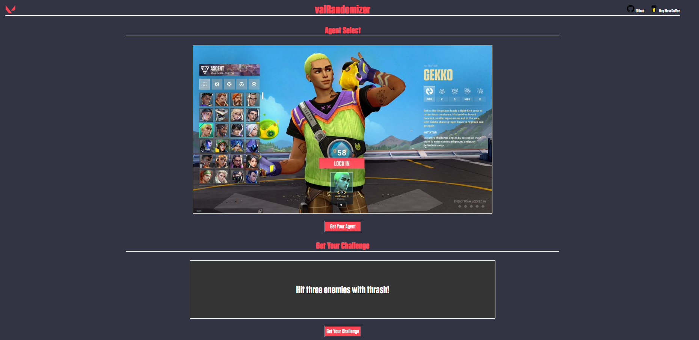

# valRandomizer

Randomized agent selection and generation of challenges to complete in-game, designed to spice up your VALORANT experience.

## Setup The Latest Build Locally
This application is not yet hosted on a domain as it is a WIP, so you'll have to download and build from the source code on your machine. Additionally, this app requires you have your own OpenAI API key which you can get [here](https://platform.openai.com/api-keys). Just putting $5 into your OpenAI account will last you countless hours of use time.

- Install node if you don't have it
  
  `Navigate to: https://nodejs.org/en/download`

- Install Angular if you don't have it

  `npm install -g @angular/cli`

- Clone this repo

  `git clone https://github.com/erik-bobinski/valRandomizer.git`

- Once the code has been downloaded

  `cd valRandomzier`

- Install the dependencies for the frontend (you must be in root of project)

  `npm install` 

- Install the dependencies for the backend (you must be in backend directory to install its dependencies: `cd Backend`)

  `npm install`

- To run the app, you must be at the root of project (you may need to step out of backend directory: `cd ../`), run the following two commands:

  `npm run backend`

  In a different terminal instance, also at root of project: Run the frontend with `npm run frontend` and navigate to the URL your terminal specifies (probably http://localhost:4200) to see your app!